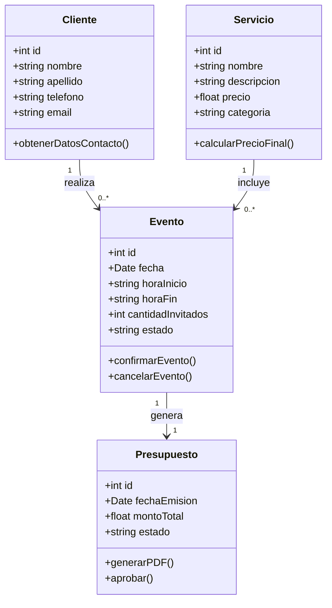

# Diagrama de Clases — Dominio Carpe Eventos

## Justificación de las entidades

- **Cliente**: quien consulta y reserva el salón. Se identificó como entidad
  porque los datos de contacto (sobre todo WhatsApp, según el documento de
  identidad visual) son el eje de la conversión del negocio.
- **Servicio**: representa cada paquete que ofrece Carpe Eventos —
  cumpleaños, bodas, bautismos, comuniones y servicio integral — tal como
  se describe en la sección "Servicios Estrella" del wireframe.
- **Evento**: la reserva concreta que une a un Cliente con un Servicio en
  una fecha y horario determinados, con su estado (Pendiente / Confirmado /
  Cancelado).
- **Presupuesto**: el documento/monto que se genera a partir de un Evento,
  reflejando el flujo real del negocio (consultan → reciben presupuesto →
  confirman por WhatsApp).

## Relaciones

| Relación | Cardinalidad | Descripción |
|---|---|---|
| Cliente → Evento | 1 a muchos | Un cliente puede realizar varios eventos a lo largo del tiempo |
| Servicio → Evento | 1 a muchos | Un servicio (ej. "Boda") puede usarse en muchos eventos distintos |
| Evento → Presupuesto | 1 a 1 | Cada evento genera un único presupuesto asociado |
