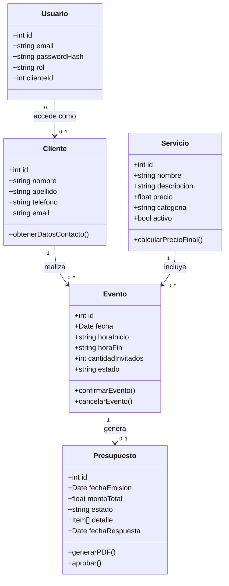

# Diagrama de Clases — Dominio Carpe Eventos

## Justificación de las entidades

- **Cliente**: quien consulta y reserva el salón. Se identificó como entidad
  porque los datos de contacto (sobre todo WhatsApp, según el documento de
  identidad visual) son el eje de la conversión del negocio.
- **Servicio**: representa cada paquete que ofrece Carpe Eventos —
  cumpleaños, bodas, bautismos, comuniones y servicio integral — tal como
  se describe en la sección "Servicios Estrella" del wireframe. `activo`
  permite darlo de baja sin perder el historial de los eventos que lo usaron.
- **Evento**: la reserva concreta que une a un Cliente con un Servicio en
  una fecha y horario determinados, con su estado (Pendiente / Presupuestado
  / Confirmado / En curso / Finalizado / Cancelado).
- **Presupuesto**: el documento/monto que se genera a partir de un Evento,
  reflejando el flujo real del negocio (consultan → reciben presupuesto →
  confirman). El monto se calcula a partir del servicio y la cantidad de
  invitados, y `detalle` guarda cada renglón del cálculo.
- **Usuario**: entidad de autenticación que el análisis del sistema
  (sección 7) pedía incorporar. Guarda las credenciales y el rol (Cliente o
  Administrador); los datos de contacto siguen en Cliente.

## Relaciones

| Relación | Cardinalidad | Descripción |
|---|---|---|
| Usuario → Cliente | 0..1 a 0..1 | Un usuario con rol Cliente accede a su registro de Cliente. Un cliente cargado por el salón (por WhatsApp) puede no tener usuario, y el Administrador no tiene Cliente |
| Cliente → Evento | 1 a muchos | Un cliente puede realizar varios eventos a lo largo del tiempo |
| Servicio → Evento | 1 a muchos | Un servicio (ej. "Boda") puede usarse en muchos eventos distintos |
| Evento → Presupuesto | 1 a 0..1 | Cada evento tiene como máximo un presupuesto: se genera cuando el salón lo cotiza (si se rechaza, se recalcula sobre el mismo) |
